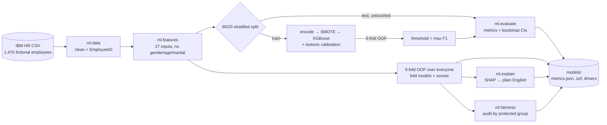

# Retain

**An honest look at predicting employee attrition.** It starts from a flawed analysis, shows
what was wrong with it, fixes it, and is clear about what the fixed model can and can't tell you.

> Screenshot: coming with the web app (Phase B).

## Before → after

The original notebook (kept unchanged in `notebooks/original.ipynb`) trained and scored the same
rows, so it reported a perfect score. Held out properly, the model is useful but far from perfect:

| Metric | Before (leaky) | After (held-out, 294 employees) | 95% CI |
|---|---|---|---|
| ROC-AUC | 1.000 | **0.790** | 0.706 – 0.867 |
| PR-AUC | 1.000 | **0.547** | 0.409 – 0.692 |
| Recall at threshold | 0.439 | **0.447** | 0.302 – 0.595 |
| Precision at threshold | 1.000 | **0.488** | 0.333 – 0.633 |

The full details (method, fairness check, limitations) are in [docs/MODEL_CARD.md](docs/MODEL_CARD.md).

## Quickstart

Requires Python 3.12 and [uv](https://docs.astral.sh/uv/).

```bash
make setup    # create .venv and install pinned dependencies
make train    # train, evaluate, write artifacts to models/ (about 1 minute)
make test     # run the test suite
make notebook # re-run notebooks/attrition.ipynb
```

On Windows without `make`, run the commands inside the Makefile directly, for example
`.venv\Scripts\python -m ml.train`.

## How it works



## Repository layout

```
ml/          the modelling package (data, features, model, evaluate, explain, fairness, score, train)
tests/       pytest suite, including a guard that no test row is ever trained on
notebooks/   original.ipynb (as it was) and attrition.ipynb (the clean walkthrough)
data/raw/    the IBM dataset and 20 unseen demo rows
docs/        model card, original report, design specs and plans
models/      generated by `make train` (gitignored)
```

## Data

[IBM HR Analytics Employee Attrition & Performance](https://www.kaggle.com/datasets/pavansubhasht/ibm-hr-analytics-attrition-dataset),
a fictional dataset created by IBM data scientists. No real people are described.

## Limitations

The model shows a method, and was trained on fictional data. Its explanations are associations,
not causes. It is not for decisions about individual people.

## License

[MIT](LICENSE) © 2026 Aniruddha Jathar
