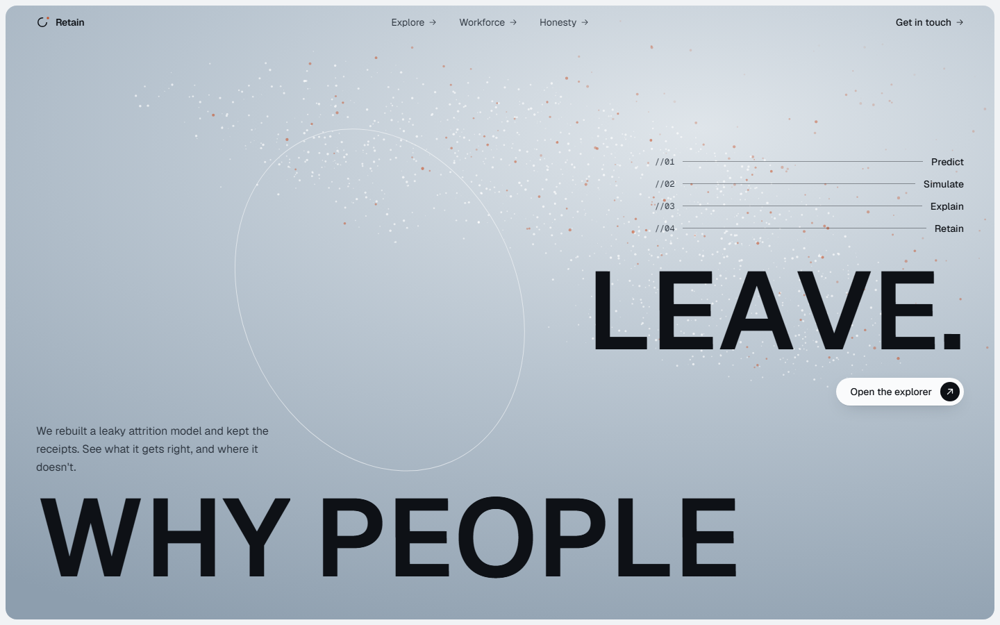
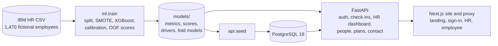

# Retain

**An honest look at predicting employee attrition.** It starts from a flawed analysis, shows
what was wrong with it, fixes it, and is clear about what the fixed model can and can't tell you.



## The app

Retain is a small HR product built on the honest model. Employees answer a short quarterly
check-in; HR sees who is drifting, why, and what would help. Every score comes from a model that
never saw that person.

- **Landing page:** the before/after story of the model, how the check-in loop works, and a
  sign-in call to action. It shows only aggregate numbers.
- **Sign-in:** email and password. No data page is public. If the free server is asleep, the
  sign-in waits for it and retries on its own.
- **HR area:** a dashboard of the open quarter (who has answered, risk by team, "Sharp drops since
  last check-in", "What would keep people here"), the people list, each person's drivers in plain
  English, a what-if panel for the things an employer can change (overtime, pay, stock options,
  level, training, travel, promotion timing), and action plans that re-score the person when
  they are finished.
- **Adding people:** HR creates a person with a work email and a temporary password. The person is
  scored straight away from colleagues in the same role, and must choose their own password the
  first time they sign in.
- **Custom questions:** HR can add multiple-choice questions to the check-in, or remove them.
  Employees answer new questions at their next check-in. Once 75% of current staff have answered,
  **Recompute probabilities** becomes available. Because nobody who answered a brand-new question
  has had time to leave, the recompute learns from the stay-intent question every check-in asks
  ("A year from now, do you see yourself still working here?"). It fits how each answer shifts
  that intent beyond what the base model predicts (L2-penalised logistic regression with the base
  log-odds as an input). It then re-scores everyone and keeps the company-wide average where the
  base model puts it. The page reports held-out AUC for stay intent, with and without the questions.
- **Employee area:** the quarterly check-in, "What would keep you here", and what HR is doing
  about it. Employees never see a score.

Gender, age and marital status are never model inputs. They appear only in the fairness check.

### Demo accounts

The sign-in page does not list them. Locally all five use the password `retain-demo` (`DEMO_PASSWORD`).
The hosted site uses a private password set on Render; the owner keeps the hosted logins in a
git-ignored `passwords.txt` at the repo root. Each account's email is listed by
`python -c "from api import demo; from api.db import SessionLocal; print(demo.personas(SessionLocal()))"`.

| Account | Story |
|---|---|
| HR manager | sees the whole company |
| Employee: sharp drop | answers fell sharply since the last check-in |
| Employee: stable | steady and happy |
| Employee: not answered | has not done this quarter's check-in yet |
| Employee: plan worked | an HR action plan brought them back |

**Daily reset.** Visitors can change things, so the demo puts itself back every 24 hours (on the
next sign-in after that) and regenerates its quarterly history when a new quarter starts (on the
next start-up). Everything is deterministic, so each reset rebuilds the same demo.

## Before → after

The original notebook (kept unchanged in `notebooks/original.ipynb`) never measured itself.
Its evaluation cell was commented out. Re-running its own predictor on all 1,470 employees
shows two problems:
- It was graded on rows it had trained on, so its ranking looks far better than it is.
- Its single-employee encoding silently zeroed every categorical input (overtime, job role, …),
  so at its 0.9 cut-off it flagged **569 of 1,470 employees (39%)** as leavers.

| Metric | Before: original predictor, in-sample, cut-off 0.9 | After: held-out, 294 employees, cut-off 0.227 | 95% CI (after) |
|---|---|---|---|
| ROC-AUC | 0.962 | **0.814** | 0.731 – 0.890 |
| PR-AUC | 0.832 | **0.600** | 0.468 – 0.731 |
| Precision | 0.409 | **0.491** | 0.365 – 0.617 |
| Recall | 0.983 | **0.617** | 0.467 – 0.773 |
| Brier score (lower is better) | 0.459 | **0.096** | 0.070 – 0.120 |

The two columns aren't measured the same way. The "before" column is what the old code would
have claimed. The "after" column is what the model actually achieves on employees it has never seen.

The full details (method, fairness check, limitations) are in [docs/MODEL_CARD.md](docs/MODEL_CARD.md).

## Run the whole app (Docker)

Requires Docker. This builds the model inside the image, starts PostgreSQL 18, the API and the site.

```bash
docker compose --profile app up --build
```

Then open http://localhost:3000 and sign in with a demo account. The API is at
http://localhost:8010/docs. The browser only ever talks to the site: the site forwards `/api/*`
to the API server-side (`API_ORIGIN`), signing each request with the shared `PROXY_SECRET`.

## Develop locally

Requires Python 3.12, [uv](https://docs.astral.sh/uv/), Node 24 and Docker (for Postgres only).

```bash
cp .env.example .env
make setup train          # Python env + model artifacts in models/
make db-up migrate seed   # Postgres on port 5433, schema, employees, demo accounts and history
make api                  # FastAPI on http://localhost:8010
cd web && npm ci && npm run dev   # Next.js on http://localhost:3000
```

Tests: `make test` (Python), `cd web && npm test` (unit) and `npx playwright test` (end to end;
starts the API and site if they are not running, and resets the demo first). The web app reads
`API_ORIGIN` and `PROXY_SECRET` at request time, so one production build runs anywhere; in
development `API_ORIGIN` defaults to http://localhost:8010.

CI lives in `ci/github-ci.yml`. To switch it on: `gh auth refresh -s workflow`, then move it to
`.github/workflows/ci.yml`.

## Deploy for free (Render + Neon)

The images are built on your machine and pushed to GitHub's container registry; Render only
pulls and runs them (free plan, Singapore, no auto-deploy).

1. Create a free Neon Postgres project and copy its connection string.
2. Let Docker push to GHCR (once):

   ```bash
   gh auth refresh -s write:packages
   gh auth token | docker login ghcr.io -u <your GitHub user> --password-stdin
   ```

3. Build and push both images, tagged with the current commit:

   ```bash
   scripts/build_images.sh            # PUSH=0 builds locally without pushing
   ```

4. On GitHub, open each package (`retain-api`, `retain-web`), Package settings, and make it public
   so Render can pull it.
5. If Render already has `retain-api` / `retain-web` services built from the repo, delete them in
   the dashboard. The script refuses to touch them.
6. Put `RENDER_API_KEY` and `DATABASE_URL` in the git-ignored `.env.deploy` (or your shell) and run:

   ```bash
   python scripts/deploy_render.py
   ```

The script creates or updates both image services, sets the API's `DATABASE_URL`,
`IP_HASH_SALT`, `PROXY_SECRET`, `SITE_ORIGINS`, `COOKIE_SECURE=true` and `DEMO_PASSWORD`, and the
site's `API_ORIGIN` and the same `PROXY_SECRET`. Secrets are generated once, kept on re-runs and
never printed. It then deploys the tag, waits until both are live and checks them. To ship a new
version, commit, run step 3 and step 6 again.

**Before a demo, open the site a minute early.** Free services sleep when idle, so the first
request after a while can take up to a minute while both wake up.

## Model only

Requires Python 3.12 and [uv](https://docs.astral.sh/uv/).

```bash
make setup    # create .venv and install pinned dependencies
make train    # train, evaluate, write artifacts to models/ (about 1 minute)
make test     # run the test suite
make notebook # re-run notebooks/attrition.ipynb
```

On Windows without `make`, run the commands inside the Makefile directly, for example
`.venv\Scripts\python -m ml.train`.

## How it works



- **Honest scores.** An 80/20 stratified split gives a test set the model never sees. The
  threshold is chosen on training data only. The scores shown in the app are 5-fold out-of-fold
  predictions, and the what-if panel re-scores a person with the fold model that never saw them.
- **Calibrated.** SMOTE inflates probabilities, so the pipeline is wrapped in sigmoid calibration.
- **Explained.** SHAP values are grouped back to the original columns and written in plain English.
- **Free to host.** The API used about 260 MB of memory in Docker after serving the full test suite.
  `DATABASE_URL` is the only database setting and accepts the `postgres://` URLs hosts hand out,
  so a free managed Postgres (Neon, Supabase, AWS free tier) needs no code changes. The seed skips
  when the database is already current and otherwise writes all rows in one statement.

## Repository layout

```
ml/          the modelling package (data, features, model, evaluate, explain, fairness, score, train)
api/         FastAPI app, SQLAlchemy models, Alembic migrations, seed script, Dockerfile
web/         Next.js site (App Router, Tailwind v4, Motion), Playwright and Vitest tests
tests/       pytest suite for the model and the API, including a leakage guard
notebooks/   original.ipynb (as it was) and attrition.ipynb (the clean walkthrough)
data/raw/    the IBM dataset and a 20-row sample (copies of dataset rows, for format tests)
docs/        model card, original report, screenshots, design specs and plans
models/      generated by `make train` (gitignored)
```

## Data

[IBM HR Analytics Employee Attrition & Performance](https://www.kaggle.com/datasets/pavansubhasht/ibm-hr-analytics-attrition-dataset),
a fictional dataset created by IBM data scientists. No real people are described.

## Limitations

The model shows a method, and was trained on fictional data. Its explanations are associations,
not causes. It is not for decisions about individual people.

## License

[MIT](LICENSE) © 2026 Aniruddha Jathar
