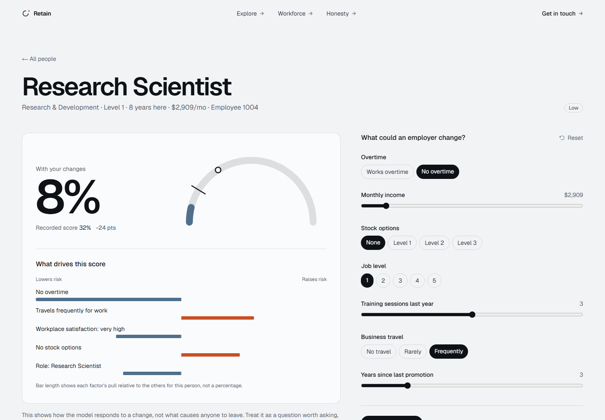
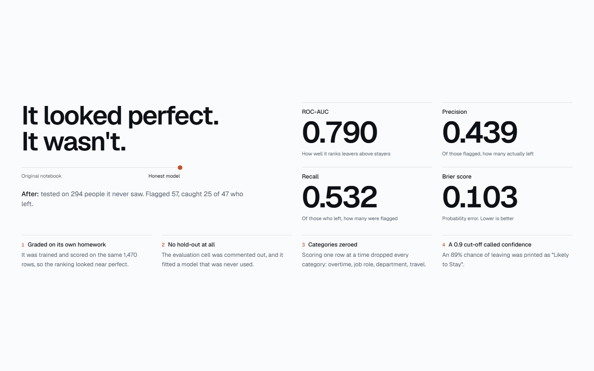
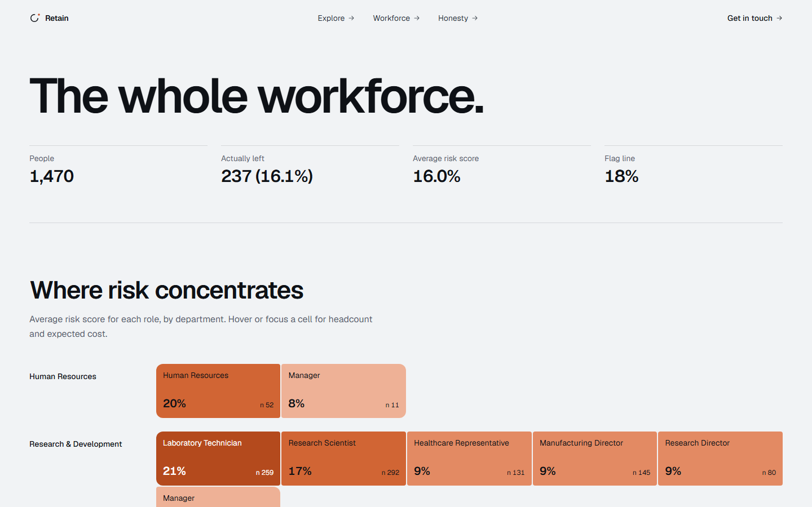
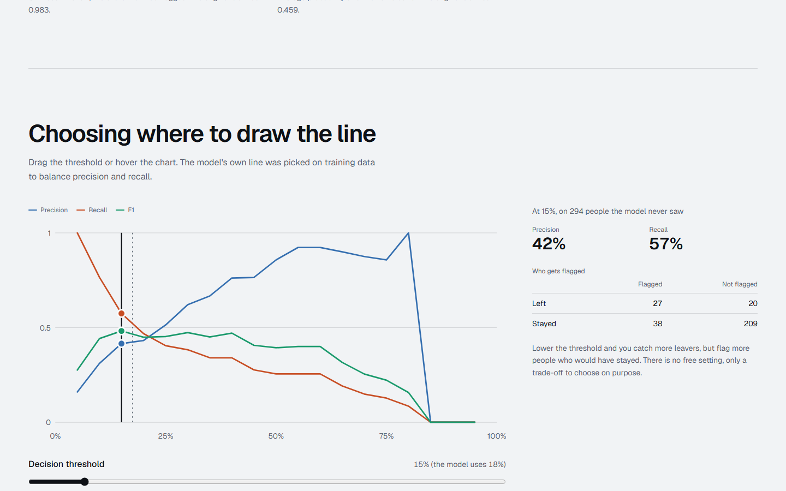
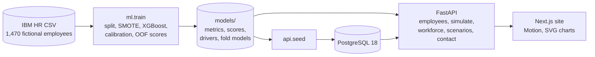

# Retain

**An honest look at predicting employee attrition.** It starts from a flawed analysis, shows
what was wrong with it, fixes it, and is clear about what the fixed model can and can't tell you.


## The app

A local web app built on the honest model. Every score it shows comes from a model that never saw
that person.

| | |
|---|---|
|  |  |
|  |  |

- **Before / after story:** scroll through the original notebook's numbers turning into the honest ones, with the four bugs that explain the gap.
- **Explorer and what-if simulator:** open any of the 1,470 fictional employees, see their risk score and its drivers in plain English, change what an employer could change (overtime, pay, stock options, level, training, travel, promotion timing) and save a shareable link.
- **Workforce map:** risk by department and role, the spread of scores, the factors that raise risk most often, and a side-by-side comparison of any two groups.
- **Cost estimate:** expected attrition cost under a replacement-cost assumption you control.
- **Ideas worth testing:** retention hypotheses tied to each factor, framed as experiments, not answers.
- **How good is this, honestly?:** metrics with 95% ranges, a threshold explorer with a live confusion matrix, a calibration plot and a fairness check.
- **Contact form:** stored in Postgres, with a honeypot and rate limiting.

Gender, age and marital status are never model inputs. They appear only in the fairness check.

## Before → after

The original notebook (kept unchanged in `notebooks/original.ipynb`) never measured itself.
Its evaluation cell was commented out. Re-running its own predictor on all 1,470 employees
shows two problems:
- It was graded on rows it had trained on, so its ranking looks far better than it is.
- Its single-employee encoding silently zeroed every categorical input (overtime, job role, …),
  so at its 0.9 cut-off it flagged **569 of 1,470 employees (39%)** as leavers.

| Metric | Before: original predictor, in-sample, cut-off 0.9 | After: held-out, 294 employees, cut-off 0.175 | 95% CI (after) |
|---|---|---|---|
| ROC-AUC | 0.962 | **0.791** | 0.708 – 0.869 |
| PR-AUC | 0.832 | **0.545** | 0.409 – 0.685 |
| Precision | 0.410 | **0.439** | 0.314 – 0.563 |
| Recall | 0.983 | **0.532** | 0.385 – 0.684 |
| Brier score (lower is better) | 0.459 | **0.103** | 0.077 – 0.130 |

The two columns aren't measured the same way. The "before" column is what the old code would
have claimed. The "after" column is what the model actually achieves on employees it has never seen.

The full details (method, fairness check, limitations) are in [docs/MODEL_CARD.md](docs/MODEL_CARD.md).

## Run the whole app (Docker)

Requires Docker. This builds the model inside the image, starts PostgreSQL 18, the API and the site.

```bash
docker compose --profile app up --build
```

Then open http://localhost:3000. The API is at http://localhost:8010/docs.

## Develop locally

Requires Python 3.12, [uv](https://docs.astral.sh/uv/), Node 24 and Docker (for Postgres only).

```bash
cp .env.example .env
make setup train          # Python env + model artifacts in models/
make db-up migrate seed   # Postgres on port 5433, schema, 1,470 employees
make api                  # FastAPI on http://localhost:8010
cd web && npm ci && npm run dev   # Next.js on http://localhost:3000
```

Tests: `make test` (Python), `cd web && npm test` (unit) and `npx playwright test` (end to end;
starts the API and site if they are not running). A production web build needs
`NEXT_PUBLIC_API_URL` set; it fails loudly without it.

CI lives in `ci/github-ci.yml`. To switch it on: `gh auth refresh -s workflow`, then move it to
`.github/workflows/ci.yml`.

## Deploy for free (Render + Neon)

1. Create a free Neon Postgres project and copy its connection string.
2. Give Render access to this repository (make it public, or grant Render's GitHub app access).
3. Run, with your own keys in the environment (never commit them):

```bash
RENDER_API_KEY=... DATABASE_URL=postgresql://...neon.tech/neondb?sslmode=require   python scripts/deploy_render.py
```

The script creates or updates `retain-api` and `retain-web` on Render's free plan, wires the
API URL and CORS origin between them, waits until both are live and checks them. Free services
sleep when idle, so the first request after a while can take up to a minute.

## Model only

Requires Python 3.12 and [uv](https://docs.astral.sh/uv/).

```bash
make setup    # create .venv and install pinned dependencies
make train    # train, evaluate, write artifacts to models/ (about 1 minute)
make test     # run the test suite
make notebook # re-run notebooks/attrition.ipynb
```

On Windows without `make`, run the commands inside the Makefile directly, for example
`.venv\Scripts\python -m ml.train`.

## How it works



- **Honest scores.** An 80/20 stratified split gives a test set the model never sees. The
  threshold is chosen on training data only. The scores shown in the app are 5-fold out-of-fold
  predictions, and the simulator re-scores a person with the fold model that never saw them.
- **Calibrated.** SMOTE inflates probabilities, so the pipeline is wrapped in sigmoid calibration.
- **Explained.** SHAP values are grouped back to the original columns and written in plain English.
- **Free to host.** The API used about 260 MB of memory in Docker after serving the full test suite.
  `DATABASE_URL` is the only database setting and accepts the `postgres://` URLs hosts hand out,
  so a free managed Postgres (Neon, Supabase, AWS free tier) needs no code changes. The seed skips
  when the database is already current and otherwise writes all rows in one statement.

## Repository layout

```
ml/          the modelling package (data, features, model, evaluate, explain, fairness, score, train)
api/         FastAPI app, SQLAlchemy models, Alembic migrations, seed script, Dockerfile
web/         Next.js site (App Router, Tailwind v4, Motion), Playwright and Vitest tests
tests/       pytest suite for the model and the API, including a leakage guard
notebooks/   original.ipynb (as it was) and attrition.ipynb (the clean walkthrough)
data/raw/    the IBM dataset and a 20-row sample (copies of dataset rows, for format tests)
docs/        model card, original report, screenshots, design specs and plans
models/      generated by `make train` (gitignored)
```

## Data

[IBM HR Analytics Employee Attrition & Performance](https://www.kaggle.com/datasets/pavansubhasht/ibm-hr-analytics-attrition-dataset),
a fictional dataset created by IBM data scientists. No real people are described.

## Limitations

The model shows a method, and was trained on fictional data. Its explanations are associations,
not causes. It is not for decisions about individual people.

## License

[MIT](LICENSE) © 2026 Aniruddha Jathar
